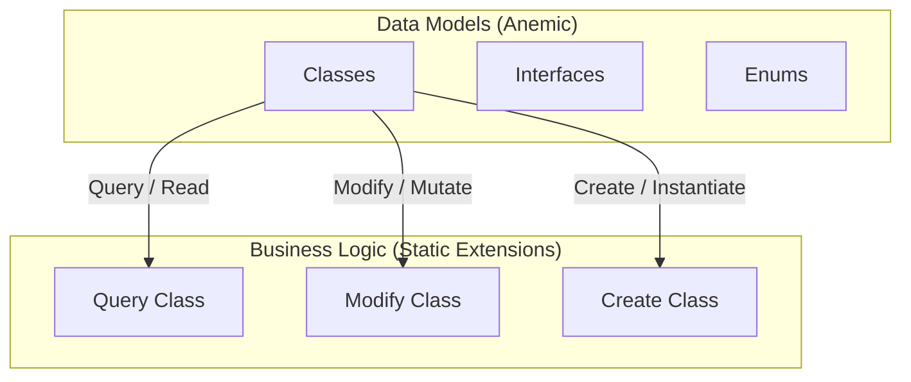

# DiGi.GIS.PostgreSQL.UI

**DiGi.GIS.PostgreSQL.UI** is a C# engineering and architectural software library suite designed for BIM and CAD integrations (such as Revit, RhinoCommon, Grasshopper, and Dynamo BIM).

---

## 🏗️ Project Architecture & Assemblies

The repository contains the following core components and assemblies:
* **[DiGi.GIS.PostgreSQL.UI.Application](DiGi.GIS.PostgreSQL.UI.Application)** (Path: `DiGi.GIS.PostgreSQL.UI\DiGi.GIS.PostgreSQL.UI.Application`)
* **[DiGi.GIS.PostgreSQL.UI](DiGi.GIS.PostgreSQL.UI)** (Path: `DiGi.GIS.PostgreSQL.UI\DiGi.GIS.PostgreSQL.UI`)

---

## 🧠 Tray task: Train YOLO detector

The client tab offers **Train YOLO detector**, which runs `UIYOLOTrainingTask`. It retrains the YOLO building detector in five steps: dataset build, label check, training, validation on the Test split, and the detector evaluation that gates the new weights. Each step can be switched off.

The run itself happens in the headless runner `DiGi.GIS.YOLO.UI.ConsoleApp --train <options file>`. That is the same executable the **Predict year built** task uses, and the row is offered only where that runner is found.

The inputs are asked for in `YOLOTrainingOptionsWindow` each time the task starts. A confirmation then names the scope back, and an environment preflight runs in the tray before anything is launched.

| Scenario | Start weights (default) | Epochs | Dataset folder |
|---|---|---|---|
| Re-train | `model.pt` beside the runner (`user files/YOLO/models/model.pt`) | 150 | appended to (`Resume` on) |
| Start from yolo26x.pt | `user files/YOLO/models/base/yolo26x.pt` beside the runner | 300 | built fresh; an existing dataset is refused |

The defaults for patience, image size, batch and seed are 50, 640, 16 and 0.

- **Place `yolo26x.pt` in the runner's `user files/YOLO/models/base/`.** It is git-ignored and deployed flattened as `YOLO/models/base/yolo26x.pt`. Its SHA-256 is recorded in the DiGi.YOLO README. Without it, a fresh run is refused before launch, and the refusal names the path.
- **Every path is made absolute in the tray before the options are written.** The runner's relative defaults are resolved against the runner's own folder.
- **The options are written beside the run folder**, not inside it, because the runner refuses a run whose folder already exists. This file is the record of the run's inputs, so it is never overwritten:
  - a run with the Training step writes `<ProjectDirectory>\<RunName>.YOLOTrainingRunOptions.json` (a taken run name is refused before launch, and an existing file refuses the run)
  - a resume writes `<ProjectDirectory>\<RunName>.resume-<yyyyMMdd_HHmmss>.YOLOTrainingRunOptions.json`, so the original run's file is left untouched
  - a run without it always writes `<ProjectDirectory>\yyyyMMdd_HHmmss.YOLOTrainingRunOptions.json`, whatever the run name box says; `_2`, `_3` ... is appended if that name is taken
- **Refused before launch:**
  - a project directory inside a `YOLO\models` folder (`DiGi.YOLO.Query.IsInsideModelsDirectory`)
  - a run name that is already taken, or is `model`
  - missing start weights
  - a missing legacy references file when the dataset step is on
  - a missing label check detector (`model.pt`) when the label check is on
  - missing gate weights when the evaluation is on
  - an interpreter without ultralytics. An empty interpreter box is settled here: the interpreter found on `PATH` that passed the check is written into the options, because the runner refuses training without one
- **The trained weights are copied to `<ProjectDirectory>\<RunName>\<RunName>.pt`.** `model.pt` is never overwritten. Shipping them is a manual decision made from the evaluation table.
- **The dataset step authorizes with the runner's own `GIS_WebAPI_Client.conf`**, not with this application's.
- **Stopping the task kills the whole process tree.**
- **Keep the runner in `bin\extensions\DiGi.GIS.YOLO.UI.ConsoleApp` current.** The tray resolves that copy before the workspace build, and a runner older than the `--train` mode ends the run with a configuration exit code.

### Resuming an interrupted run

When the run name and project directory name a run whose folder holds an unfinished `weights\last.pt` and no completed `<RunName>.pt`, the dialog shows `Interrupted after epoch N of M - resume at epoch N+1?` (N is the last completed epoch; the runner logs the same resume as "Resuming … from epoch N+1 of M") under the run name and offers **Resume interrupted run**. Ticking it locks what a resume cannot change — the start weights, epochs, patience, image size, batch and seed come from the checkpoint, and the dataset build is switched off — because `DiGi.YOLO` restores them and refuses a resume that rebuilds the dataset. Device, interpreter, working directory, gate weights and the steps after training stay editable; the Training step is still required.

The run continues `weights\last.pt` at the next epoch in the same folder, then copies, re-checks, validates and evaluates exactly as a fresh run. A resumed run is **not bit-identical** to an uninterrupted one. The preflight repeats every refusal the runner makes, before launch: the training step not selected, the dataset step selected, the folder or `last.pt` missing, `<RunName>.pt` present, the checkpoint unreadable, finished, recording a missing dataset, or recording a project or name that was moved or renamed. **Closing the application or a power cut still stops the run** — resume shortens the recovery, it does not prevent the interruption.

### Stalls and automatic resumes

A training can stop producing output while staying alive — a data-loader deadlock holds the GPU with every process at 0 % CPU — or its process can die with a driver fault. `Automatic resumes` (default 3) sets `YOLOTrainingRunOptions.AutoResumeCount`; `Stall limit` (minutes, empty for the runner's 15) sets `InactivityTimeout`. Both are enabled only with the Training step.

- A run that stalls or crashes is continued from its own `weights\last.pt`, up to the count, each time after copying the checkpoint to `weights\last_autoresume<N>_<yyyyMMdd_HHmmss>.pt`. A stop from the tray is never resumed, and neither is a refusal before the process started or a finished checkpoint.
- The runner logs `Training stalled at epoch E (last output hh:mm:ss) - automatic resume N of M`, or `Training exited with code X at epoch E - automatic resume N of M`, preceded by the last 30 lines of the crashed attempt's error output (`  | …`, its traceback), or by `The attempt that exited with code X wrote no error output - …` when a process ended from outside wrote none. The attempt that ends the run is logged the same way, ending `- no automatic resume left (M of M used)` (or `- automatic resume is off (AutoResumeCount 0)`), and the closing `Resumed automatically N time(s): Stalled at epoch E (hh:mm:ss), …` names the same interrupted epochs, and prints `Resumed automatically N time(s): …` at the end; the tray logs every line.
- A run that exhausts the count fails with the last reason named, not the generic "reported failure without an exception" text. A power cut, a reboot or closing the application still stops the run — that recovery is the operator resume above.

---

## 📐 Core Architectural Pattern (DiGi.Core Pattern)

This project strictly separates **Data Models** (anemic schemas) from **Business/Calculation Logic** (static extension methods). All new features must strictly follow this pattern.



### 1. Data Models (Classes, Interfaces, Enums)
* **Classes:** Place in the `/Classes` directory (Namespace: `[Project].Classes`). Keep them simple and lightweight (properties and basic constructors only). **Do NOT** put complex logic inside these classes.
* **Interfaces:** Place in the `/Interfaces` directory (Namespace: `[Project].Interfaces`).
* **Enums:** Place in the `/Enums` directory (Namespace: `[Project].Enums`).

### 2. Business Logic (Extension Methods)
ALL complex functionalities, including operations on classes, interfaces, and enums, MUST be implemented as **Extension Methods** inside static partial classes in `/Query`, `/Modify`, `/Create`, or `/Convert` directories:
* **Query (Read/Extract):** Static partial class `Query` returning results based on a query without modifying the source object.
* **Modify (Update/Mutate):** Static partial class `Modify` modifying the state or properties of the existing object in place.
* **Create (Instantiate):** Static partial class `Create` instantiating and returning a new object.
* **Convert (Parse/Format/Transform):** Static partial class `Convert` converting, formatting, or transforming an object into another representation.

---

## 💻 Coding Guidelines for Developers & AI Agents

All developers and AI agents follow these always-applicable rules (Visual Studio 2026, C#). Task-specific detail lives in
the guidelines listed in §9 — read the one matching the task.

### 1. General coding standards
1. **English only** — identifiers and comments.
2. **No `var`** unless the compiler forces it; target-typed `new()` (`PointNode pointNode = new();`, avoids IDE0090) and
   collection expressions (`List<int> numbers = [];`, avoids IDE0028).
3. **Naming:** camelCase starting with the type name, `_`-suffixed qualifier when needed (`PointNode pointNode_Base`); an
   acronym type lowercases only its first letter (`gISPostgreSQLConverterManager`). Collections: pluralized element type
   (`filterConditions`, `point3Ds` — not `listConditions`). A property named after its unique, descriptive type
   (`public AggregateFunction AggregateFunction { get; set; }`). Primitives: plain camelCase.
4. **Zero warnings/analyzer messages.**
5. **Block-scoped namespaces** (`namespace DiGi.Domain { ... }`); file-scoped are prohibited (`.editorconfig`). The template
   pins `LangVersion` 12; most repositories use `latest`, core libraries target `netstandard2.0` — use
   `System.Threading.Lock` only in net9+ projects at C# 13+.
6. **Parameter line breaks (`<= 7` rule, `DIGI0001`):** ≤ 7 parameters on one line however long; ≥ 8 one per line. Line
   length is never the trigger. Call sites prefer one line; multi-line for complex expressions, lambdas, initializers.
   ```csharp
   public void Calculate(double centerX, double centerY, double radius, double? storeyHeight = null)
   ```
7. **Async method names end with `Async`.**
8. **`CancellationToken` is always the LAST parameter (CA1068)** — every method and overload; add new optional parameters
   before it and reorder the `<param>` tags. At call sites **name every argument after a skipped default**
   (`commandTimeout: 30`, `cancellationToken: cancellationToken`) so an inserted parameter fails to compile instead of
   rebinding. Detect: `grep -rnE "CancellationToken [a-zA-Z_]+( = default)?, " --include=*.cs .`
   ```csharp
   public static async Task<bool> ClearAsync(NpgsqlConnection? npgsqlConnection, string tableName, int commandTimeout = 30, CancellationToken cancellationToken = default)
   ```
9. **Simplify member access (IDE0002) — then rebuild.** C# binds the first segment innermost-outwards with no fallback:
   from `DiGi.GIS.PostgreSQL.UI.Classes`, `WebAPI` is `DiGi.GIS.WebAPI`, so `DiGi.WebAPI.Query.GetAsync` keeps its prefix.
   When same-named extension methods can both apply, call the intended one fully qualified — the `using` decides silently.
10. **Separate projects**, not one monolithic solution.
11. **Output optimization:** no filler; only the necessary code, logic or explanation.
12. **Temporary code carries `TODO [MarkerName]:`** — a PascalCase name of the **migration**, reused at every site so one
    `grep` is the deletion checklist, stating the observable **removal condition** and the tracking issue. A workaround
    for another DiGi repository's defect is temporary too (removal condition = the upstream fix). Never tag permanent code.
13. **`ToString()` is not a key** — identity strings render through `CultureInfo.InvariantCulture` (`"R"` with `-0.0`
    folded, `G29` for `decimal`); `pl-PL` files `[0,5, 12,25]` and nothing throws. Reference: `DiGi.Typology.Visual.Query.Key`.
14. **A member resolved by name through reflection is a contract on the whole hierarchy** — document it at both ends,
    probe `GetMethod` rather than reason about it.
15. **No caching in an optimization unless the request explicitly allows it** — remove allocations and repeated
    enumeration first; propose a cache with its measurement and ask.
16. **Log through `Serilog.Modify.Log`** with structured templates (`"{Type}: … {CountyId}"`, never interpolation);
    `Log(exception, …)` always logs at Error.
17. **Rethrow only a requested cancellation:**
    `catch (OperationCanceledException) when (cancellationToken.IsCancellationRequested) { throw; }` before any general catch.

### 2. Architecture (DiGi.Core pattern)
Data models are anemic; behavior is static extension methods. Never a service/manager class for behavior (process-wide
registries are `*Manager`s on `Settings` or DI singletons).
- **`/Classes`** (`[Project].Classes`), **`/Interfaces`**, **`/Enums`**. Category folders (`Classes/Options`,
  `/BackgroundTask`, `/Result`, `Convert/ToX`) add **no** namespace segment — it would change the `_type` discriminator.
- **`Query`** (read-only, property-like names: `BoundingBox()`, only `Is`/`Has`/`Try` prefixes), **`Modify`** (mutates),
  **`Create`** (builds), **`Convert`** (`/Convert/To[TargetArea]/[TargetType].cs`, `ToSystem_String`, `ToEPW_DateTime`) —
  `Convert` is the first choice for any conversion, never an instance method on the model.
- **Interface-contract members are instance methods on the class** — geometry primitives (`Polygon2D`, `Circle2D`, …
  implementing `IBoundable2D`, `ITransformable2D`, `IClosedCurve2D`) are deliberately not anemic; never move them.
- **Constructors stay cheap** (assign and clone only); validation and cleanup go in a `Create` factory named after the
  type, returning `null` for invalid input — materialise → clean up → then validate.
- **One public method per file** in `/Query`, `/Modify`, `/Create` (overloads together); nested types in
  `[Outer].[Inner].cs`; **no private methods** in these classes (public helper or local function).
- **`IResult` types end in `Result`** (`TerrainPointDensityResult`); the name is wire contract, so existing violations are
  not renamed opportunistically.
- Enums start with `Undefined` (`-1` only where `0` is real); tolerances come from `DiGi.Core.Constants.Tolerance`
  (`Distance` 1e-6, `MicroDistance`, `MacroDistance`, `Angle`).

### 3. Project assets — `files/` vs `user files/` (never commit secrets)
Committed, non-sensitive deployment assets go in `files/`; **secrets, credentials, machine-specific settings and
generated reports go in the git-ignored `user files/`** (`[Uu]ser [Ff]iles/` in `.gitignore`; verify with
`git check-ignore -v "user files/x.conf"`). Both are copied flat into the output (`CopyUserFiles` runs after `CopyFiles`,
so `user files/` wins) — and `user files/` **ships** with every deploy, so training data and model variants live outside
the workspace. A file a build copies into a project (`gltf-viewer-core.js`, `gis-theme.css`) is edited only at its source.

### 4. Host dependencies — `HintPath` drops a library's NuGet packages
DiGi projects reference each other by `HintPath`, which NuGet and MSBuild cannot follow: a host must **re-declare every
package its libraries need, at the same version** (unless its framework provides it), or it fails at run time with a
`FileNotFoundException` per item — a **partial result reported as success**. `dotnet test` never rebuilds the library
under test: build it first. Verify with `CheckHostDependencies.ps1`.

### 5. References (`IReference` / `IUniqueReference`)
**Never compare two interface-typed references with `==`** (a silent reference comparison; accessors clone per call).
Use `Core.Query.Equals(reference_1, reference_2)`.

### 6. Serialization (`SerializableObject`)
A serializable class implements `I<Project>SerializableObject`, keeps `private readonly` fields tagged
`[JsonInclude, JsonPropertyName(nameof(Prop))]`, exposes them as `[JsonIgnore]` get-only properties, uses
`DateTimeOffset` for dates, and has exactly three constructors:
```csharp
public Holiday(string? name, string? date)
{
    this.name = name;
    this.date = date;
}

public Holiday(Holiday? holiday) : base(holiday)
{
    if (holiday != null)
    {
        name = holiday.name;
        date = holiday.date;
    }
}

public Holiday(JsonObject? jsonObject) : base(jsonObject) { }
```
Copy constructor: primitive lists `new List<T>(source)`, nested objects `Core.Query.Clone(item)` element by element.

### 7. Documentation and tests
- **XML docs:** every public member, params in signature order, one `<summary>`, no blank lines (`<para>`), no docs on
  `partial` declarations. Read `documentation/API/<Assembly>/` before opening `.cs` source.
- **xUnit:** `[ProjectName].xUnit`, `public partial class Facts` in `/Facts`, a `<summary>` on every fact, shared fixtures
  in `DiGi.Test/files/`, written reports in `DiGi.Test/user files/reports/`. Every serializable class gets a fact ending in
  `Core.xUnit.Query.SerializationCheck(instance)` **plus** a direct copy-constructor assertion. Tolerance facts test just
  inside and just outside; benchmarks are measured in isolation with a warm-up. Slow facts are `[MediumFact]`/`[LongFact]`.
- **Interactive front ends** are verified in a real browser (Playwright), asserting rendered output, not state flags.

### 8. Branches and releases
Work is committed on the active version branch (the highest bare SemVer branch, e.g. `0.8.5`) — no feature branch,
worktree or pull request unless asked; push only when asked. **A version bump / release runs only on an explicit request:**
merge the version branch into `main`, bump the patch (`0.8.2` → `0.8.3`), branch it off `main`, update
`Directory.Build.props` `<Major>`/`<Minor>`/`<Build>`, push both (`git push -u origin <version_branch>`).

### 9. Full guideline set
Canonical, task-specific guidelines live in `DiGi.Maintenance/documentation/AI Guidelines/` (relative to the workspace
root) and are mirrored per repository as skills under `.agents/skills/<skill-name>/SKILL.md`.

| Guideline | Read it when |
|---|---|
| `Coding - General.md` | Writing or editing any C# code. |
| `Coding - Serialization.md` | Creating or changing a serializable type or options class; debugging a JSON round trip. |
| `Coding - Host Dependencies.md` | Adding a NuGet package; a host failing with `FileNotFoundException` or a partial result; `CS0012`/`CS0246` build walls. |
| `Coding - Project Setup.md` | New project or repository, `.editorconfig`, `Directory.Build.props`, analyzers. |
| `Coding - Automatic Tests.md` | Writing xUnit facts. |
| `Coding - Performance.md` | Optimizing, benchmarks, parity tests, the wiki `Benchmark.md` page. |
| `Coding - References.md` | Comparing or keying an `IReference` / `IUniqueReference`. |
| `Coding - Geometry.md` | Orienting, closing, triangulating, hashing or sweeping geometry. |
| `Coding - ComputeSharp.md` | Writing or changing a ComputeSharp `IComputeShader`. |
| `Coding - Grasshopper.md` | Grasshopper/Rhino plug-in components. |
| `Coding - Background Tasks.md` | Tray-application background tasks and their dialogs. |
| `Coding - WPF Deferred Loading.md` | A WPF window needing slow data; WPF layout checks. |
| `Coding - YOLO.md` | The YOLO Year Built detector. |
| `Coding - Laya.md` | The Laya decision model. |
| `Coding - WebAPI GLTF.md` | Web APIs on the `DiGi.GLTF` 3D framework. |
| `Coding - WebAPI Contracts.md` | Changing a WebAPI route/parameter/controller or writing an HTTP client. |
| `Coding - WebAPI Simple Authorization.md` | API-key tiered authorization. |
| `Coding - Deployed WebAPI.md` | Testing against `api.digiproject.uk`; which server runs what. |
| `Coding - Browser Testing.md` | Verifying interactive front-end behaviour in a real browser. |
| `Coding - GIS Administrative Data.md` | Anything keyed by a county code or id; the Subdivision layer. |
| `Coding - PostgreSQL.md` | PostgreSQL/Npgsql code, production vs development databases. |
| `Coding - PostgreSQL Distributed Queue Processing.md` | Distributed claim/acknowledge update queues. |
| `XML Documentation.md` | Reading generated API docs; adding or auditing XML docs. |
| `GitHub - Branches and Commits.md` | Where to commit, the pre-commit sweep, plan files, pulling all repos, releases. |
| `GitHub - Issues.md` | Creating, editing, verifying and closing issues; dependencies. |
| `GitHub - Labels.md` | Labels and the mandatory `ai: *` tier. |
| `GitHub - Sub-Issues.md` | Sub-issues for a multi-repository feature. |
| `GitHub - Workspace Setup.md` | Folder layout and new-machine setup. |
| `GitHub Wiki.md` | Editing wiki pages. |
| `Maintenance - Scripts.md` | `DiGi.Maintenance/Scripts`; scripted edits and line endings. |
| `Maintenance - AI Guidelines Propagation.md` | Adding, splitting or removing a guideline. |

> **One data rule worth knowing before it bites you:** a GIS county `code` does **not** identify one row — 406 county
> rows (one per polygon part) cover 380 codes. Key every write and lookup by county **`id`**, give every
> `LIMIT`/`FirstOrDefault` an `ORDER BY`, never deduplicate those rows, resolve every item's part against `building_2d`
> whatever number of ids arrived, and read building-keyed tables with `fallbackByReference: true`
> (`Coding - GIS Administrative Data.md`).
